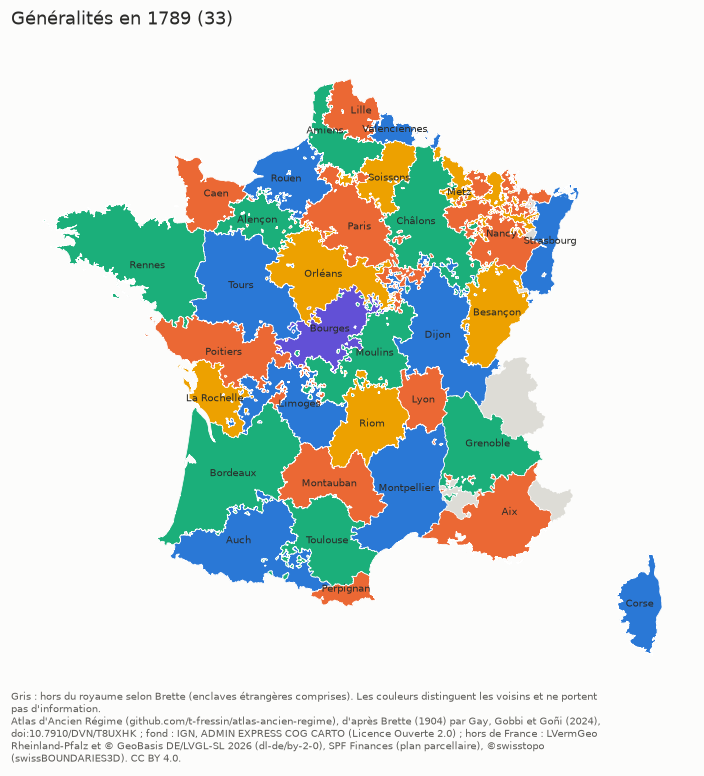
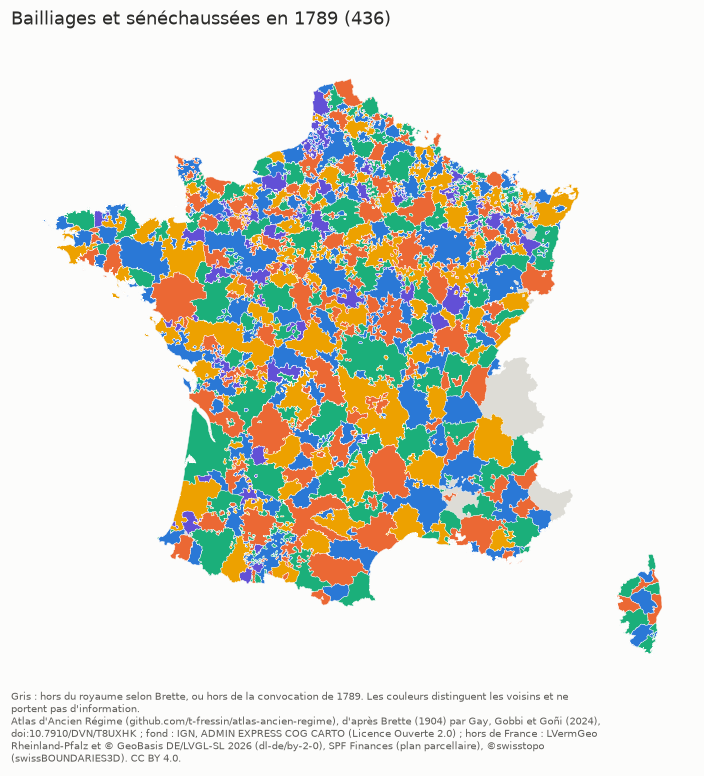
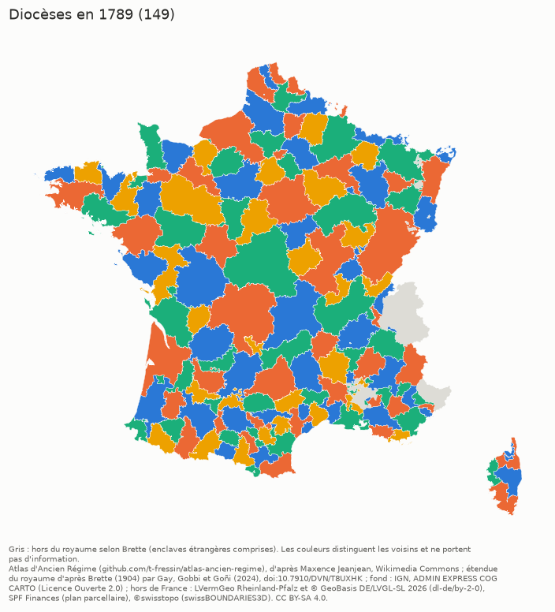
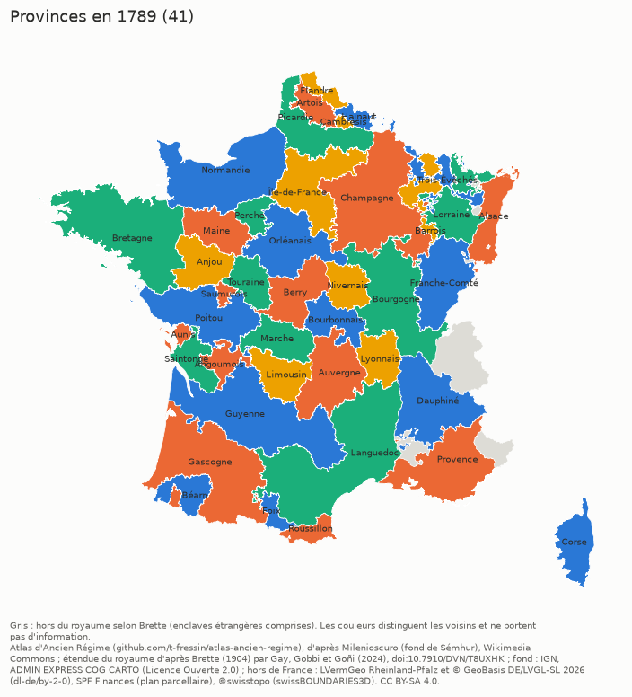
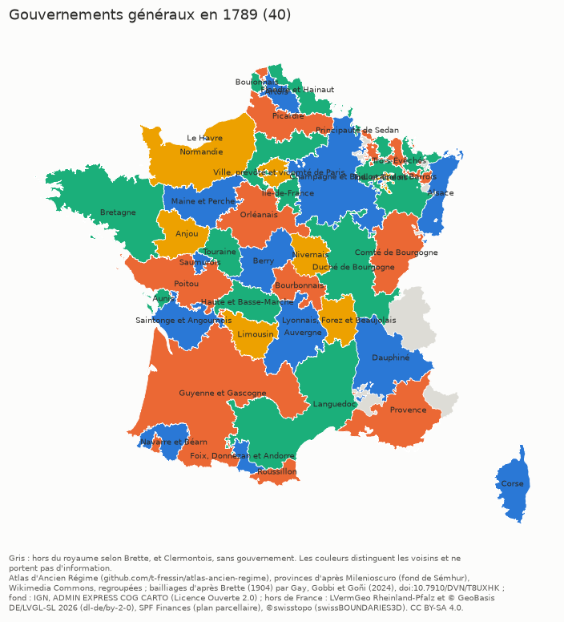
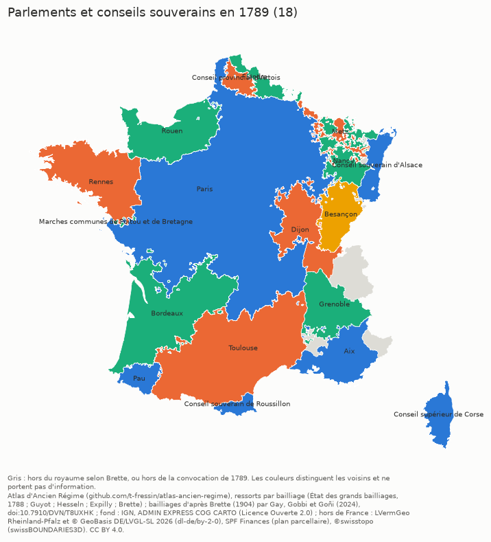

# Atlas d'Ancien Régime : généralités, bailliages, diocèses, provinces, gouvernements et parlements en 1789

Couches GeoJSON des **généralités**, des **bailliages et sénéchaussées**, des **diocèses**, des **provinces**, des **gouvernements généraux militaires** et des **parlements et conseils souverains** du royaume de France en 1789, construites de façon reproductible à partir de sources ouvertes et rattachées aux communes actuelles, de sorte que les couches se superposent exactement.

| Couche | Fichier | Entités | Source principale | Licence des données |
|---|---|---|---|---|
| Généralités | `donnees/generalites/generalites_1789.geojson` | 33 (Toulouse et Montpellier séparées) | Brette, *Atlas des bailliages* (1904), par Gay, Gobbi et Goñi (2024) | CC BY 4.0 |
| Généralités, Languedoc réuni | `donnees/generalites/generalites_1789_languedoc_uni.geojson` | 32 | idem | CC BY 4.0 |
| Bailliages et sénéchaussées | `donnees/bailliages/bailliages_1789.geojson` | 436 (circonscriptions de la convocation des États généraux, dont Sarrelouis, hors de France) | idem | CC BY 4.0 |
| Diocèses | `donnees/dioceses/dioceses_1789.geojson` | 149 (diocèses étrangers réduits à leurs paroisses du royaume) | cartes de Maxence Jeanjean, Wikimedia Commons | CC BY-SA 4.0 |
| Provinces | `donnees/provinces/provinces_1789.geojson` | 41 | cartes de Milenioscuro, Wikimedia Commons | CC BY-SA 4.0 |
| Gouvernements généraux | `donnees/gouvernements/gouvernements_1789.geojson` | 40 | ordonnance de 1776 ; provinces regroupées et bailliages de Brette | CC BY-SA 4.0 |
| Parlements et conseils souverains | `donnees/parlements/parlements_1789.geojson` | 18 | ressort de chaque bailliage de Brette (État des grands bailliages, 1788 ; Guyot ; Hesseln ; Expilly) | CC BY 4.0 |
| Territoires du royaume aujourd'hui hors de France | `donnees/exterieurs/territoires_exterieurs_1789.geojson` | 119 | anciens villages (*Gemarkungen*), divisions cadastrales belges, communes suisses ; rattachements sourcés (Brette 1907, Durival, Expilly, Hesseln) ; aussi ajoutés à chaque couche | CC BY 4.0 |

Coordonnées en WGS 84 (longitude, latitude). Propriétés : `docs/donnees.md`.

**Tableau des lieux** : `donnees/lieux/lieux_1789.csv` réunit en un seul tableau, une ligne par commune actuelle (et par territoire aujourd'hui hors de France), l'entité de chaque couche, sa certitude, les décisions prises (corrections, confirmations, doutes, communes partagées) et leurs sources (CC BY-SA 4.0 ; colonnes : `docs/donnees.md`).

| | |
|---|---|
| [](docs/images/hd/generalites_1789.png) | [](docs/images/hd/bailliages_1789.png) |
| [](docs/images/hd/dioceses_1789.png) | [](docs/images/hd/provinces_1789.png) |
| [](docs/images/hd/gouvernements_1789.png) | [](docs/images/hd/parlements_1789.png) |

Aperçus (cliquer sur une image pour la version en haute définition), sous la licence de la couche représentée. Les couleurs ne servent qu'à distinguer deux entités voisines.

## À lire avant usage

* **Fiche de chaque couche** : sources, méthode pas à pas, corrections, limites et points ouverts dans `docs/couches/` ([généralités](docs/couches/generalites.md), [bailliages](docs/couches/bailliages.md), [diocèses](docs/couches/dioceses.md), [provinces](docs/couches/provinces.md), [gouvernements](docs/couches/gouvernements.md), [parlements](docs/couches/parlements.md), [territoires extérieurs](docs/couches/exterieurs.md)).
* **Précision** : celle de la commune actuelle, non de la paroisse de 1789 (`docs/methode.md`). Les communes formées par fusion de paroisses relevant d'entités différentes sont rattachées en bloc, sauf pour les généralités et les bailliages.
* **Diocèses et provinces** : ce sont des **cartes d'après Wikipédia**. Les tracés de Commons ne citent pas leurs sources ; l'atlas les cale et les rattache aux communes, il ne les valide pas.
* **Provinces** : la province n'avait pas, en 1789, de définition administrative précise (Armand Brette, *Les limites et les divisions territoriales de la France en 1789*, 1907, p. 57-59). La couche est une convention, celle des cartes de Commons.
* **Étendue du royaume** : celle de Brette (Gay, Gobbi et Goñi, 2024) pour toutes les couches, aux corrections sourcées près (`docs/corrections.md`). Les enclaves étrangères (Comtat Venaissin, Montbéliard, Sarrewerden, Salm, Mulhouse, Bidache, Llívia…) restent vides : leur liste, commune par commune, est dans `docs/vides_1789.md`. Les diocèses sont coupés à la même étendue : un diocèse étranger (Bâle, Trèves, Spire, Liège, Tournai, Ypres…) n'y figure que pour ses paroisses du royaume.
* **Corrections et points à vérifier** : `docs/corrections.md`. Chaque correction est appuyée sur une source lue, citée (ouvrage, tome, page quand elle a pu être établie, identifiant ou adresse Internet Archive ; `docs/sources.md`), et inscrite dans `sources/corrections.json` ou les tables de `sources/`, appliquées à la construction des couches. Pour 891 des 1 294 corrections de généralité (69 %), la page imprimée d'au moins une source n'a pas pu être établie (« page imprimée non établie », avec le feuillet d'Internet Archive quand il est connu) ; les pages données « d'après la pagination d'Internet Archive » ont été contrôlées sur les en-têtes de page voisins du texte OCR, et écartées quand ils la contredisaient ; la vedette et l'identifiant Internet Archive permettent de retrouver le passage.
* **Gouvernements** : les gouvernements généraux n'avaient pas de limites fixées (Brette 1907, p. 100 et 104) : la couche est une convention, faite des provinces regroupées et, pour Le Havre, le Boulonnais, Sedan, Toul et Paris, des bailliages de Brette ; le Clermontois ne dépendait d'aucun gouvernement.
* **Parlements** : la cour suit le bailliage de convocation ; les partages à l'intérieur d'un bailliage (Dunkerque, Bourbourg et Gravelines, au conseil d'Artois, dans le bailliage de Bailleul ; paroisses mi-parties) ne sont pas représentés.
* **Territoires extérieurs** : Sarrelouis, la Lorraine allemande, Landau, les villages de la Lauter (souveraineté contestée par l'Empire, propriété `contestation`), Philippeville, Mariembourg, Agimont et le pays de Gex cédé en 1815 sont dessinés à l'échelle des anciens villages actuels (limites cadastrales d'aujourd'hui, non celles de 1789) ; les lieux mi-partis, contestés ou incertains sont dans la table sans être dessinés.
* **Bailliages** : unités électorales de la convocation de 1789 (« bailliages ou juridictions assimilées »), non ressorts judiciaires complets ; les terres absentes de la convocation (comté de Montjoie-Vaufrey, par exemple) n'ont pas de bailliage, même rattachées à une généralité.
* **Généralités** : la généralité de chaque paroisse est celle de son bailliage de convocation aux États généraux, selon Brette, corrigée par élection là où le bailliage débordait sur une généralité voisine (correction en cours : `docs/couches/generalites.md`).

## Réalisation avec l'intelligence artificielle

L'atlas a été réalisé avec l'aide d'une intelligence artificielle (Claude Code, d'Anthropic) : le code, la recherche documentaire (lecture des sources en ligne, relevé des citations, propositions de corrections) et la documentation ont été produits par l'IA, sur les consignes de l'auteur, qui a fixé le projet et la méthode et pris les décisions d'arbitrage. Le détail, les limites et la manière de vérifier : `docs/ia.md`.

## Citer

Citer l'atlas :

> Thomas Fressin, *Atlas d'Ancien Régime : généralités, bailliages, diocèses, provinces, gouvernements, parlements et territoires extérieurs en 1789*, version 1.0.0, 2026, https://t-fressin.github.io/atlas-ancien-regime/ (données : https://github.com/t-fressin/atlas-ancien-regime).

```bibtex
@dataset{fressin_atlas_ancien_regime_2026,
  author  = {Fressin, Thomas},
  title   = {Atlas d'Ancien Régime : généralités, bailliages, diocèses, provinces, gouvernements, parlements et territoires extérieurs en 1789},
  version = {1.0.0},
  year    = {2026},
  url     = {https://t-fressin.github.io/atlas-ancien-regime/}
}
```

Citer l'atlas (`CITATION.cff`) **et** les sources dont la couche utilisée dérive (`docs/sources.md`, et la propriété `source` de chaque entité). Les couches sous CC BY-SA 4.0 imposent que toute version modifiée soit diffusée sous la même licence.

## Construction

Les couches sont produites par une chaîne de traitement que l'auteur conserve et ne publie pas ; `docs/ia.md` dit comment elle a été réalisée. Les tables de décisions (`sources/`) et les empreintes SHA-256 des sources utilisées (`sources/empreintes.json`, `sources/commons_entites.json`) sont publiées : chaque valeur des couches peut être rapportée à sa source.

## Licences

* **Données** : licence indiquée dans chaque dossier de `donnees/` (`LICENCE.md`) et dans la propriété `licence` de chaque entité.
* **Documentation** : CC BY 4.0 (`docs/LICENCE.md`), sauf les aperçus de `docs/images/`, qui suivent la licence de la couche représentée (CC BY 4.0 pour les généralités, les bailliages et les parlements, CC BY-SA 4.0 pour les diocèses, les provinces et les gouvernements) et portent son attribution.

